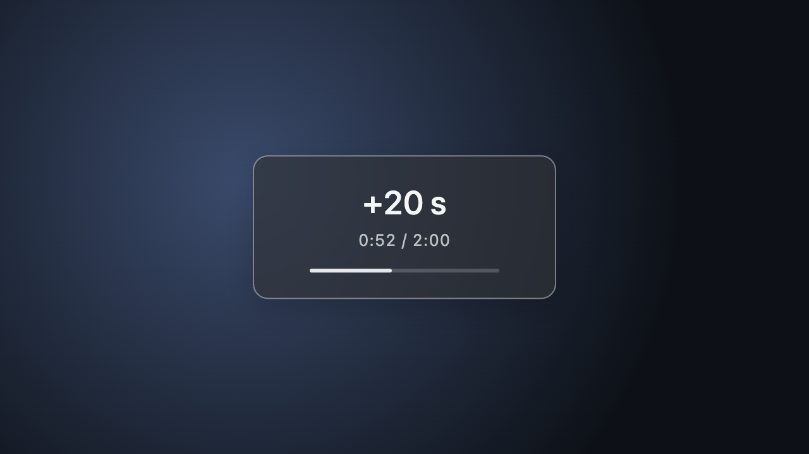
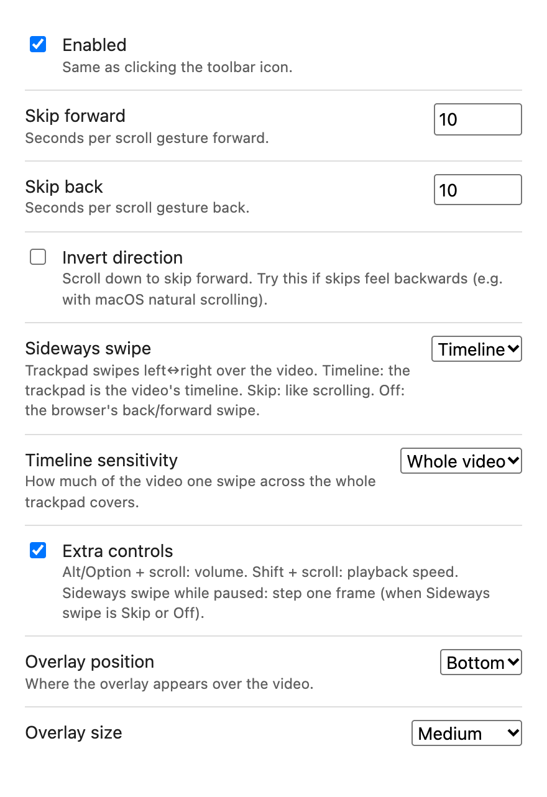

# YouTube Scroll to Skip

A small browser extension that lets you skip forward or backward in a YouTube video by scrolling over the player. No clicking, no arrow keys, no reaching for the seek bar.

- Scroll **up** over the video → skip **forward** 10 seconds
- Scroll **down** over the video → skip **backward** 10 seconds
- On a trackpad, the trackpad is the video's **timeline**: a swipe across the whole trackpad, left→right, covers the whole video. Swipe a little to move a little, right→left to go back.

(Both lengths can be set separately.)

A small panel over the player confirms each skip: how far the video actually moved in large type (`+10 s`), where you landed (`4:32 / 12:05`), and a thin progress bar. Quick repeated skips on the same video add up (`+30 s`). Near the end or start it shows the real, shorter jump, or `End` / `Start` when there's nowhere left to go. It's a translucent grey panel with a thin light border and system fonts, with no icons. Its position and size can be changed in the settings.



## Features

- **One gesture = one skip**, even with trackpad momentum scrolling, and quick swipes in a row each count. The page never scrolls underneath the player while you skip. Pressing a modifier mid-scroll (say, Alt for volume) counts as a new gesture, so it isn't swallowed.
- **No accidental skips**: a gesture has to move at least a little (15 px, a fraction of one wheel notch) before it acts, so a resting finger on a Magic Mouse or a brushed trackpad does nothing.
- **Trackpad timeline**: sideways swipes scrub through the video, with the time and progress bar shown live. Scrubbing stops when your fingers lift (macOS momentum is ignored). A sensitivity setting makes long videos finer (a full swipe = half, a quarter or a tenth of the video). Up/down swipes still skip. A wobbly swipe counts in its overall direction, not the direction of a single event.
- **Settings**: forward and back skip lengths, invert direction, sideways swipe mode and timeline sensitivity, extra controls, overlay position and size, and on/off.
- **On/off from the toolbar**: click the extension icon. An `OFF` badge shows when it's disabled.
- **Extra controls** (can be turned off):
  - Alt/Option + scroll: volume
  - Shift + scroll: playback speed (0.25×–4×)
  - Volume and speed go through YouTube's own player, so its volume slider and speed menu stay in sync. Speeds above YouTube's 2× limit are applied to the video directly.
  - Sideways swipe while paused: step one frame, when sideways swipes are set to Skip or Off (stays inside the video, and stops short of the end like skips do)
- **Works on** `www.youtube.com`, `m.youtube.com` and `music.youtube.com`, plus embedded players, including privacy-mode `youtube-nocookie.com` embeds.
- **Live streams**: skips stay within the stream's seekable (DVR) window.
- **Gets out of the way**:
  - Ctrl/Cmd + scroll (zoom) is never intercepted.
  - `/shorts/` pages keep their native scroll-to-next gesture.
  - Ads can't be skipped through.
  - Scrolling the player's quality/speed menus scrolls the menu.
  - Hover previews in the feed are ignored.
  - Outside the video, two-finger back/forward swipes still navigate (or everywhere, with "Sideways swipe" set to Off).
  - Forward skips stop just before the end, so they don't trigger autoplay of the next video.
- **Accessible**: the toast is announced to screen readers (`role="status"`).
- **Private**: the only permission is `storage` (to save your settings). No tracking and no network requests.

## Installation

The extension isn't on the Chrome Web Store yet, so you install it manually as an "unpacked" extension.

### Chrome, Edge, Brave and other Chromium browsers

1. Download or clone this repository.
2. Go to `chrome://extensions` and turn on **Developer mode** (top right).
3. Click **Load unpacked** and select the folder that contains `manifest.json`.

### Firefox (128+)

Go to `about:debugging#/runtime/this-firefox`, click **Load Temporary Add-on…** and pick `manifest.json`. Firefox support is untested.

## Usage

Hover over a video and scroll. Scrolling anywhere outside the player behaves normally.

## Settings

Right-click the toolbar icon → **Options** (or use the **Details → Extension options** link in `chrome://extensions`). Changes apply immediately, including in open tabs, and sync across your signed-in browsers.

| Setting          | Default | What it does                                                         |
|------------------|---------|----------------------------------------------------------------------|
| Enabled          | on      | Same as clicking the toolbar icon                                    |
| Skip forward     | 10      | Seconds per forward scroll gesture (1–600)                           |
| Skip back        | 10      | Seconds per backward scroll gesture (1–600)                          |
| Invert direction | off     | Scroll down = forward (and right→left = forward). Try it if the default feels backwards, e.g. with macOS natural scrolling |
| Sideways swipe   | Timeline | Timeline: the trackpad is the video's timeline. Skip: like scrolling. Off: the browser's back/forward swipe |
| Timeline sensitivity | Whole video | How much of the video one swipe across the whole trackpad covers: whole, half, quarter or tenth |
| Extra controls   | on      | Alt+scroll volume, Shift+scroll speed, sideways swipe while paused for one frame |
| Overlay position | Bottom  | Bottom, Centre or Top of the player                                  |
| Overlay size     | Medium  | Extra small (0.65×), Small (0.8×), Medium, Large (1.3×) or Extra large (1.6×) |

An invalid skip length (outside 1–600) is rejected and the previous value is kept. If you used 1.2.x, your old "seconds per skip" is carried over to both directions when the extension updates.



Finer tuning (the gesture gap, the minimum gesture distance, how long skips keep adding up, the end guard, volume and speed steps) is in the constants at the top of `content.js`.

## How it works

The content script (`content.js`, with the shared defaults from `defaults.js`) runs in YouTube pages and their frames. It listens for `wheel` events in the capture phase, so it sees them before YouTube's own handlers do. For each event it:

1. Backs off if the extension is disabled, Ctrl/Cmd is held, or you're on `/shorts/`.
2. Finds the player under the cursor (`#movie_player`, `#shorts-player` or `.html5-video-player`) and the `<video>` inside it. It skips player popups and feed hover previews.
3. Backs off if that player is showing an ad.
4. Decides what the event means: skip, volume, speed, frame step, or nothing (the event is then left for the page).
5. Calls `preventDefault()`. It only acts on the first event of a gesture; a gesture ends after 200 ms without wheel events, or when the action changes (e.g. Alt pressed mid-scroll). A gesture acts once it has moved 15 px in total.

Seeks and frame steps are clamped to `video.seekable`. The toast is placed inside the player, or inside `document.fullscreenElement` when needed, because only the fullscreen element's subtree is drawn in fullscreen.

Volume and speed changes go through `page-bridge.js`. It runs in the page's own JavaScript world (`"world": "MAIN"`), so it can call YouTube's player API (`setVolume`, `setPlaybackRate`). The content script can't call that API directly: it runs in an isolated world, sees the same DOM, but not the page's JavaScript objects. The two scripts talk through a DOM event. If the API is missing, the content script changes the `<video>` itself.

`background.js` handles the toolbar toggle and badge, and `options.html`/`options.js` are the settings page.

## Development

```sh
npm install      # dev tooling only (Playwright)
npm test         # end-to-end tests in headless Chromium
npm run package      # dist/yt-scroll-skip-<version>.zip for store upload
npm run screenshots  # regenerates docs/toast.png and docs/options.png
```

The tests load the real extension into Playwright's Chromium and serve `test/fixture.html` (a fake YouTube player with a generated silent audio track and a fake player API) at `www.youtube.com` URLs, then fire real wheel events at it. They also cover the options page and the toolbar toggle. GitHub Actions runs them on every push to `main` and every pull request, and uploads the store zip as a build artifact. After editing, also reload the extension in `chrome://extensions` and try it on real YouTube.

The screenshots come from the same fixture (no real YouTube content), so they show the toast and options page, not a real video.

### Publishing to the Chrome Web Store

1. Bump `version` in `manifest.json` and run `npm run package`.
2. Upload the zip in the [Chrome Web Store developer dashboard](https://chrome.google.com/webstore/devconsole).
3. Add at least one 1280×800 screenshot and a 128×128 icon.
4. Privacy: the extension collects no user data. Justify `storage` as "saves the user's settings".

## Project structure

```
.
├── manifest.json      # Manifest V3 (Chrome service worker + Firefox background scripts)
├── defaults.js        # Default settings, shared by content and options scripts
├── content.js         # Wheel handling, seeking, modifier controls, toast
├── page-bridge.js     # Page-world bridge to YouTube's player API (volume/speed)
├── background.js      # Toolbar on/off toggle and badge
├── options.html/.js   # Settings page
├── icon.png
├── test/              # Playwright end-to-end tests + fake YouTube fixture
├── scripts/
│   ├── package.sh     # Builds the store zip
│   └── screenshots.mjs # Regenerates the README screenshots
├── docs/              # README screenshots
├── .github/workflows/ # CI: runs the tests and builds the zip on every push/PR
└── LICENSE            # MIT
```

## License

MIT. See [LICENSE](LICENSE) for details.
